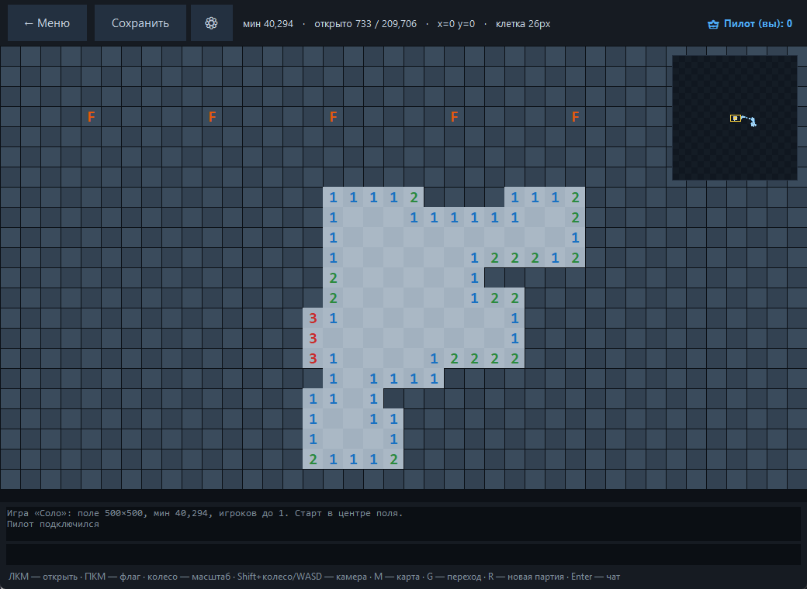
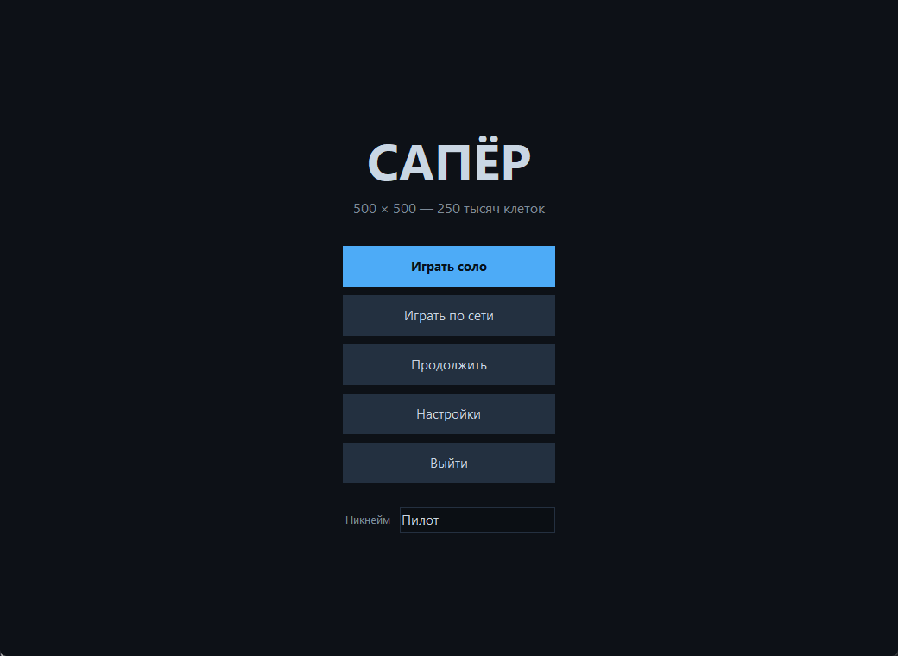
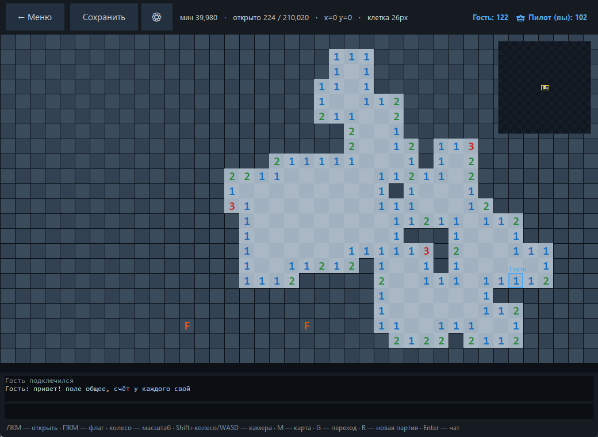
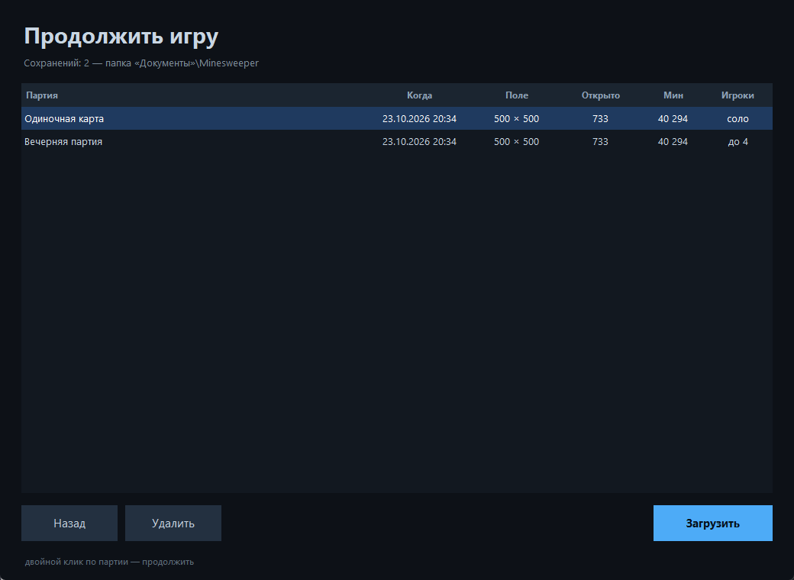

<div align="center">

<h1>Сапёр 500 × 500</h1>

<p>
  <strong>Классический сапёр с мультиплеером по локальной сети.</strong><br>
  Одно общее поле на всю команду, личный счёт, чат и курсоры друзей.<br>
  Python 3.13 + tkinter, без внешних зависимостей.
</p>

<p>
  <a href="https://www.python.org/"></a>
  
  
  
  
  
</p>



</div>

## Возможности

- 🌐 **Сеть до 32 игроков** — общее поле, личный счёт, чат, курсоры и
  миникарта друзей; пароль и лимит мест.
- 💾 **Сохранения** — соло- и сетевые партии; загрузка сетевой снова
  поднимает игру в локальной сети с тем же полем.
- 🗺️ **Миникарта 160 × 160** — заполненность поля, окно просмотра
  и позиции игроков.
- ⚡ **Быстрое поле** — 250 тыс. клеток на битмасках: генерация ~2 мс,
  открытие области за миллисекунды.
- 🖱️ **Удобная камера** — колесо меняет масштаб, `Shift`+колесо и `WASD`
  двигают, край окна прокручивает как в RTS.
- 🎛️ **Настройки** — ник, звуки, громкость, миникарта; всё запоминается
  между запусками.
- 📦 **Готовый exe** — один файл для Windows 10/11, Python на том ПК
  не нужен.
- 🎨 **Одно окно** — меню, список игр, создание, сохранения и поле
  без лишних диалогов.

## Скриншоты

<table>
  <tr>
    <td width="50%"><br>
      <sub>Меню: соло, сеть, сохранения, настройки и никнейм</sub></td>
    <td width="50%"><br>
      <sub>Сетевая партия: общее поле, счёт, флаги, чат и курсор гостя</sub></td>
  </tr>
  <tr>
    <td width="50%"><br>
      <sub>Соло: крупные числа, флаги, миникарта и зум</sub></td>
    <td width="50%"><br>
      <sub>Продолжение: дата, поле, прогресс, мины и режим игры</sub></td>
  </tr>
</table>

## Быстрый старт

### Windows, без Python

1. Скачайте [`game/Minesweeper-500x500.exe`](game/Minesweeper-500x500.exe).
2. Запустите двойным кликом — консольного окна нет.
3. «Играть соло» — и поле готово. Или «Играть по сети» → «Создать игру».

При первом запуске Windows может спросить разрешение брандмауэра — разрешите
доступ для частных сетей, иначе друзья не подключатся. SmartScreen может
предупредить о «неизвестном издателе»: «Подробнее» → «Выполнить в любом случае».

### Из исходников

```
py -3.13 main.py
```

На Windows можно дважды кликнуть `start.bat` (или `start.vbs` — совсем без
мелькания консоли). Если игра упала при старте без консоли, текст ошибки
пишется в `%TEMP%\minesweeper-lan.log`.

## Как играть по сети

1. **Хозяин:** «Играть по сети» → «Создать игру» — название, число мест,
   необязательный пароль. Игра сразу появляется в списке у всех в локальной сети.
2. **Остальные:** «Играть по сети» → двойной клик по игре в списке
   (или `Enter`). Если игра с паролем — введите его.
3. **Автопоиск не сработал** (другая подсеть, VPN): «Прямое подключение» и
   адрес хозяина, например `192.168.1.10:5555`. Адрес виден в чате игры.

Правила простые: поле и флаги общие, очко за каждую открытую клетку — каждому
своё, а одна мина заканчивает партию всей команде. Новую партию запускает
только хозяин (`R`); если хозяин вышел, его место занимает следующий игрок.
Хозяин может сохранить партию и позже загрузить её — игра снова появится
в сети, и все продолжат с того же поля.

Выделенный сервер без окна:

```
py -3.13 main.py --server --game-name Вечер --max-players 6 --password 1234
```

## Управление

| Действие | Клавиша / мышь |
| --- | --- |
| открыть клетку | ЛКМ |
| поставить / снять флаг | ПКМ |
| масштаб | колесо мыши (от себя — ближе), `+` / `-` |
| двигать камеру | `Shift`+колесо, `WASD`, стрелки, `PageUp/PageDown` |
| двигать камеру мышью | зажать среднюю кнопку и тянуть |
| ехать к краю окна | подвести курсор к краю — камера поедет сама (зона 84 px) |
| прыжок по координатам | `G` |
| в центр поля | `Home` |
| миникарта | `M` — скрыть/показать, клик — прыжок |
| чат | `Enter` (выход — `Esc`) |
| новая партия | `R` (только у хозяина игры) |

Первый клик всегда безопасен: мины из окрестности переносятся в другие места,
не меняя их количество.

## Сохранения

Кнопка **Сохранить** есть и в соло, и в сетевой игре — сохраняет тот, кто
хостит (у остальных поле живёт на компьютере хозяина). Файлы `.saper` лежат
в `Документы\Minesweeper` и весят ~30 КБ: битовые карты поля сжимаются `zlib`
и хранятся в JSON строками base64.

В сохранении — мины, открытые клетки, флаги, счёт, камера и масштаб, а для
сетевой партии ещё название и число мест (пароль не пишется). Продолжить:
меню → **Продолжить** → двойной клик по партии. Соло-партия поднимается как
соло, сетевая — снова в локальной сети, с тем же полем и теми же открытыми
клетками; счёт начинается заново.

## Сборка exe

```
py -3.13 -m pip install pyinstaller
py -3.13 -m PyInstaller --onefile --windowed --name Minesweeper-500x500 ^
    --icon icon.ico --add-data "icon.ico;." main.py
```

Готовый файл появится в `dist/`; для поставки он копируется в `game/`.

## Как это устроено

Поле — не массив объектов, а ряды Python-`int`: 500 рядов по ~70 байт, все
операции (соседи, открытие области, генерация мин) идут битовыми масками
целыми рядами. Сервер авторитетен: клиент присылает только «открой (x, y)»,
«поставь флаг» и «покажи такое-то окно», а в ответ летят лишь изменившиеся
клетки — поэтому 250 тыс. клеток спокойно живут по сети.

Подробности — в [`docs/ARCHITECTURE.md`](docs/ARCHITECTURE.md): битмаски,
протокол, миникарта, дельта-отрисовка, формат сохранений и синтез звука.

## Проверки

| Команда | Что проверяет |
| --- | --- |
| `py -3.13 tests/test_board.py` | ядро: сверка с наивным сапёром на 25 полях + бенчмарк |
| `py -3.13 tests/test_net.py` | протокол: пароль, лимит, два клиента, флаги, чат, подрыв, права хозяина, миникарта |
| `py -3.13 tests/test_ui.py` | интерфейс: меню, сохранения соло и сети, прямое подключение, зум колесом, миникарта, автопрокрутка (нужен рабочий стол) |

## Структура

```
main.py                  запуск: меню с игрой или только сервер
start.bat / start.vbs    запуск без консоли
icon.ico                 иконка окна и exe
game/                    готовый Minesweeper-500x500.exe + памятка
docs/                    архитектура и скриншоты
minesweeper/board.py     поле на битмасках
minesweeper/server.py    TCP-сервер, игроки, пароль, автопоиск, миникарта
minesweeper/client.py    окно на tkinter: меню, настройки, сохранения, игра
minesweeper/saves.py     сохранения партий в «Документах»
minesweeper/sounds.py    синтез и проигрывание звуков
minesweeper/protocol.py  константы, палитра, широковещательный поиск
tests/                   проверки ядра, сети и интерфейса
tools/                   служебные скрипты: скриншоты для README
```

## Ключи запуска

| Ключ | Значение |
| --- | --- |
| `--host HOST` | сразу подключиться к серверу, минуя меню |
| `--port N` | порт, по умолчанию 5555 |
| `--name ИМЯ` | имя игрока |
| `--density P` | плотность мин 0…0.95, по умолчанию 0.16 |
| `--seed N` | фиксированное зерно стартового поля |
| `--discover` | найти игру в сети и сразу войти |
| `--server` | только сервер, без окна |
| `--game-name ИМЯ` | название игры для `--server` |
| `--max-players N` | мест в игре для `--server` |
| `--password ПАРОЛЬ` | пароль игры для `--server` |

## Мелочи

* Настройки (ник, звук, громкость, миникарта, последний адрес) — в
  `%APPDATA%\minesweeper-lan.json`, сохранения — в `Документы\Minesweeper`.
* Порт 5555 занят другой игрой? Новая займёт свободный — он виден в списке и чате.
* `--density 0.05` даёт огромные пустые области, `--density 0.25` — хардкор.
* Пароль идёт по сети открытым текстом: защита от случайного входа, не шифрование.
* Звук можно выключить; без `winsound` (не-Windows) игра работает молча.

<div align="center">
<sub>Сделано на Python 3.13 и tkinter · Windows 10/11 · приятной игры!</sub>
</div>
